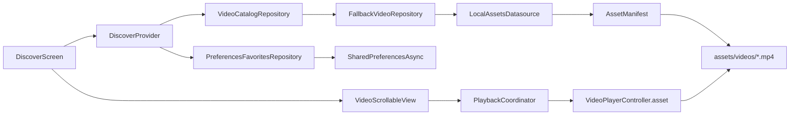
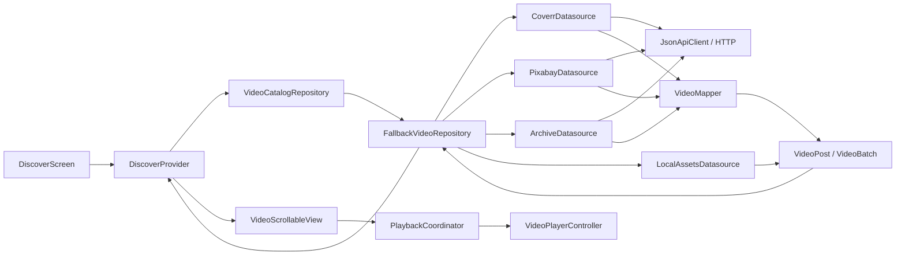

# Práctica 04 · TokTik

TokTik simula un feed de videos cortos: reproduce el video visible y permite avanzar o retroceder con desplazamiento vertical. Incluye Discover, For You, Favorites, favoritos persistentes, control de sonido, descripción expandible, temas estacionales y fuentes de video locales y remotas.

## Ejecutar la práctica

Desde la raíz del repositorio, en PowerShell:

```powershell
Set-Location .\Practica04\toktik
flutter pub get
flutter devices
flutter run -d emulator-5554
```

Usa el ID que muestre `flutter devices`. Las claves son opcionales; sin ellas la app intenta Internet Archive y los videos incluidos en `assets/videos/`. Para probar APIs autenticadas, configura `api_keys.json` localmente y agrega `--dart-define-from-file=api_keys.json` al comando. No incluyas claves reales en el repositorio.

## Evidencias en video

Graba los flujos en el emulador y reemplaza cada espacio con un enlace accesible para el profesor (Drive, OneDrive o video adjunto).

| Evidencia | Qué mostrar | Enlace al video |
|---|---|---|
| 1. Feed y reproducción | Desplazamiento vertical, loop, pausa, sonido, widgets y gestos | **Pegar enlace aquí** |
| 2. Interacción y persistencia | Favorito/me gusta, reinicio de la app y descripción “Ver más” | **Pegar enlace aquí** |
| 3. Temporadas | Automático por fecha, selección manual, paleta, iconografía e intro con audio | **Pegar enlace aquí** |
| 4. Fuentes y arquitectura | Discover / For You / Favorites, selección y respaldo de datasources | **Pegar enlace aquí** |

Aplicación de videos verticales para **Desarrollo Móvil Integral**, construida con Flutter y Dart. Su objetivo es aplicar arquitectura CLEAN, peticiones HTTP, estado reactivo, reproducción multimedia y persistencia local en una experiencia de videos cortos.

El proyecto existente se conserva en `Practica04/toktik/`. Su nombre de paquete es **`toktik_app`** y su nombre visible, **TokTik**. Las prácticas 02 y 03 permanecen intactas.

## Entorno y dependencias

SDK comprobado: **Flutter 3.47.4**, **Dart 3.13.3**, canal stable. Restricción Dart del proyecto: `^3.13.2`. `pubspec.lock` conserva las versiones resueltas para esta aplicación.

| Paquete | Versión resuelta | Responsabilidad |
|---|---|---|
| provider | 6.1.5+1 | Estado reactivo e inyección de dependencias |
| video_player | 2.14.1 | Videos, loop, volumen y controladores |
| http | 1.6.0 | Peticiones a las APIs |
| shared_preferences | 2.5.6 | Preferencias y favoritos con API asíncrona |
| audioplayers | 6.8.1 | Audio original de temporada |
| intl | 0.20.3 | Formato compacto de contadores |
| animate_do | 4.2.0 | Dependencia conservada de la base; transiciones actuales con Flutter |

También se conservan los iconos Cupertino de la base y `flutter_lints`. Las versiones se resolvieron mediante `flutter pub get`; el APK debug compiló e instaló en el emulador disponible. La comprobación de reproducción en frío sigue pendiente, descrita abajo.

## Funcionalidades

- **Discover:** catálogo disponible ordenado por vistas; no inventa un sistema de recomendación.
- **For You:** PageView vertical, carga adicional cerca del final cuando la fuente tiene más páginas y recorrido repetido del catálogo cuando se agota.
- **Favorites:** conserva videos guardados aunque se cambie de fuente, gracias a identificadores estables y metadatos persistentes.
- Autoplay exclusivo del video visible, loop, toque para pausar/reanudar, botón de sonido y máximo de tres controladores en memoria.
- Precarga de vecinos, liberación de controladores fuera de la ventana, estados de carga, errores y reintento. La inicialización tiene un límite de 20 segundos.
- Pausa inmediata al cambiar de sección o pasar a segundo plano. Una pausa manual se respeta al regresar a primer plano.
- Corazón unificado para favorito/me gusta: suma exactamente uno al contador base y lo resta al desmarcar. No modifica los contadores del servidor.
- Descripción limitada a dos líneas; “Ver más” y “Ver menos” sólo cuando el texto excede ese espacio. El desplazamiento interno se activa únicamente en el panel expandido.
- Fuente, creador y licencia cuando se proporcionan. Los videos locales empiezan con cero estadísticas; no se presentan métricas inventadas de popularidad.
- Selector de fuente, regreso explícito a Aleatoria, temporadas automáticas/manuales y audio temático opcional.
- Interfaz oscura, superposiciones, gradientes, transiciones y navegación con áreas seguras. Los selectores se validaron a 320 × 640.

## Arquitectura CLEAN

### Diagrama 1: Provider con catálogo local

Con la fuente local seleccionada, el Provider conserva estado y favoritos; el repositorio localiza los MP4 del bundle y el coordinador administra el reproductor del elemento visible.



### Diagrama 2: Provider, repositorio y múltiples datasources

El mismo contrato permite alternar fuentes. El repositorio prueba la seleccionada, valida y deduplica resultados, y continúa con fuentes disponibles si no obtiene videos reproducibles.



```text
lib/
├── main.dart                          # Composición e inyección
├── config/
│   ├── api/api_config.dart            # dart-define y límites HTTP
│   ├── helpers/                       # Formato de números
│   └── theme/                         # Colores, iconos, tipografía y tiempos
├── domain/
│   ├── entities/                      # VideoPost, VideoBatch, fuente y temporada
│   ├── datasources/                   # Contrato de fuentes y errores
│   └── repositories/                  # Catálogo, favoritos, preferencias, audio
├── infrastructure/
│   ├── datasources/                   # Coverr, Pixabay, Archive y assets
│   ├── mappers/                       # Respuestas JSON ↔ VideoPost
│   ├── repositories/                  # Respaldo, persistencia y audioplayers
│   └── storage/                       # Adaptador SharedPreferencesAsync
└── presentation/
    ├── providers/                     # Discover, Settings, Playback, ThemeAudio
    ├── screens/discover/              # Tres secciones del feed
    ├── shared/                        # PageView y acciones
    └── widgets/                       # Ajustes, reproductor y descripción
```

El dominio utiliza Dart puro y no importa Flutter ni plugins. Los widgets no procesan respuestas HTTP. Los repositorios y datasources se inyectan; el cliente HTTP compartido se cierra al liberar la aplicación. Las tres secciones pertenecen a una pantalla; no se creó una carpeta de router vacía.

El repositorio prueba primero la fuente seleccionada, omite fuentes sin credenciales, rechaza URLs incompatibles, descarta resultados incompletos y deduplica por ID. Si no obtiene contenido, intenta las otras fuentes. Aleatoria mezcla el orden de consulta. La UI muestra la fuente efectiva; los motivos del respaldo están en **Fuentes y temas → Estado de las fuentes**. Si todas fallan, muestra un estado sin contenido y permite cambiar la fuente o reintentar.

La validación del catálogo comprueba estructura, URL y formato declarado; la compatibilidad definitiva del decodificador se comprueba al inicializar `video_player`. Una respuesta HTTP correcta no garantiza que todos sus videos se puedan reproducir.

## APIs y configuración

Las claves se leen exclusivamente en `lib/config/api/api_config.dart` mediante `String.fromEnvironment`. No hay claves reales versionadas.

| Fuente | Endpoint y procesamiento |
|---|---|
| Coverr | `https://api.coverr.co/videos`, Bearer, páginas desde 0 y `urls=true`; convierte `hits` y `urls.mp4_preview`/`urls.mp4` |
| Pixabay | `https://pixabay.com/api/videos/`, parámetro `key`, páginas desde 1 y safesearch; selecciona una variante MP4 válida de `videos` |
| Internet Archive | `https://archive.org/advancedsearch.php` para buscar IDs y `https://archive.org/metadata/{identifier}` para localizar MP4; URL de descarga formada a partir del nombre real del archivo |
| Videos locales | Descubre MP4 existentes en `assets/videos/` mediante AssetManifest |

Se verificaron los contratos con la documentación oficial de [Coverr (videos)](https://api.coverr.co/docs/videos/), [Coverr (autenticación)](https://api.coverr.co/docs/auth/), [Pixabay](https://pixabay.com/api/docs/), [búsqueda de Internet Archive](https://doc-tools.readthedocs.io/en/ia-test-gsod/item-search-apis.html) y [metadatos de Internet Archive](https://archive.org/developers/md-read.html).

Internet Archive busca material con licencia declarada CC0 o CC BY 4.0; procesa dos consultas de metadatos a la vez, omite archivos privados, H.265 declarado y archivos mayores de 80 MB, y elige una variante por ítem. La atribución y licencia recibidas se conservan. Una declaración del uploader no sustituye revisar los derechos antes de redistribuir contenido. Coverr exige respetar sus condiciones de atribución; antes de publicar una integración habilitada con clave, completa y verifica su atribución visual oficial.

Las peticiones usan timeout de 12 segundos. HTTP no exitoso, JSON inválido, respuestas vacías y falta de claves producen respaldo o un mensaje claro, sin mostrar claves ni trazas internas. No se simulan respuestas en la aplicación. Las respuestas sintéticas se utilizan exclusivamente en pruebas unitarias.

### Instalación y ejecución en PowerShell

Desde la raíz del repositorio:

```powershell
Set-Location .\Practica04\toktik
flutter --version
flutter pub get
flutter devices
flutter run
```

Sin claves funcionan Videos locales e Internet Archive cuando hay conexión. Para probar localmente sin Android:

```powershell
flutter run -d chrome
```

Para guardar las claves localmente, ejecuta este script y escríbelas cuando PowerShell las solicite. La entrada no se muestra y `api_keys.json` está excluido de Git:

```powershell
.\scripts\save_api_keys.ps1
```

Después, inicia la app pasando el archivo al compilador:

```powershell
flutter run -d emulator-5554 --dart-define-from-file=api_keys.json
```

`api_keys.json` está ignorado por Git. Aun así, `--dart-define-from-file` no protege las claves dentro de un binario distribuido; para producción, usa un backend intermediario y revisa las condiciones de las cuentas. Reinicia la ejecución al cambiar los defines.

También puedes usar el lanzador con entrada oculta de PowerShell; no guarda las claves en un archivo:

```powershell
.\scripts\run_with_api_keys.ps1 -Device chrome
```

### Videos locales y audio original

Se incluyen tres loops verticales H.264 de 360 × 640 y seis segundos, y tres secuencias WAV de tonos originales. Su creación está documentada en [assets/LICENSE.md](assets/LICENSE.md). No se descargó música ni se copió contenido visual de terceros para el respaldo.

Agrega tus propios MP4 autorizados en `assets/videos/` y ejecuta nuevamente `flutter pub get`/`flutter run`. La carpeta ya está declarada; los archivos se descubren automáticamente. Los archivos distintos a los tres originales se identifican como videos locales sin atribución o licencia inventada. Los archivos locales también deben ser compatibles con el dispositivo.

La regeneración es opcional; los recursos ya están incluidos. Requiere Python y FFmpeg con libx264:

```powershell
python .\scripts\generate_resources.py --ffmpeg "C:\ruta\a\ffmpeg.exe"
```

## Persistencia y temporadas

SharedPreferencesAsync guarda JSON en dos claves:

- `toktik.favorite_catalog.v2`: IDs, metadatos y URL de los favoritos; el me gusta se deriva del estado de favorito. Una escritura guarda ambos estados juntos.
- `toktik.preferences.v1`: fuente seleccionada, temporada manual o null para Automático, silencio y audio temático.

Se pueden leer los IDs de la implementación anterior (`toktik.favorites.v1`) para migrarlos cuando el video vuelve a aparecer. v2 es autoritativa, incluso vacía. Los errores de escritura de favoritos restauran el estado anterior; una preferencia fallida no reemplaza el último valor guardado. Cambiar la URL de un archivo local cambia su identidad. Las URLs remotas pueden caducar; un favorito guarda metadatos, no descarga el video ni garantiza disponibilidad offline.

| Tema automático | Periodo | Apariencia |
|---|---|---|
| Halloween | Todo octubre | Negro, naranja, morado y luna |
| Navidad | Todo diciembre | Verde, rojo, dorado y árbol |
| San Valentín | 1–14 de febrero | Rosa, rojo y corazón |
| Normal | Resto del año | Oscuro y turquesa |

La fecha se revisa al volver a primer plano y a medianoche local. La selección manual prevalece hasta elegir Automático y se conserva tras reiniciar. Los temas cambian la paleta, iconografía, familia tipográfica y duración de las animaciones; la tipografía concreta depende de las fuentes del sistema.

El audio temático está apagado inicialmente. `ThemeAudioProvider` serializa sus operaciones y sólo permite audio temático cuando el video está silenciado o pausado y la aplicación está en primer plano. `PlaybackCoordinator` espera a que el audio temático se detenga antes de reproducir video con volumen. Si detenerlo falla, bloquea el sonido del video y muestra un error de reproducción. El tema Normal no tiene pista.

## Diagramas publicables

- [Diagrama inicial](architecture/initial/index.html).
- [Diagrama final](architecture/final/index.html).
- [Detalles y recibos de los diagramas](architecture/README.md).

Son HTML independientes con SVG integrado, controles y temas claro/oscuro. Sus rutas de publicación son relativas, aptas para GitHub Pages. Ambos pasaron las validaciones automáticas de Archify, incluida la comprobación en navegador. No se afirma una inspección visual humana. Describen el árbol de trabajo local; no se atribuyeron archivos sin commit a un SHA del historial.

## Pruebas y resultados

```powershell
flutter pub get
flutter analyze
flutter test
flutter build web
python .\scripts\probe_archive.py
```

Resultados de la revisión actual:

- `flutter analyze`: sin incidencias antes del ajuste de límites de inicialización.
- **43 pruebas unitarias aprobadas** en la suite enfocada de TokTik; después de ampliar los límites de espera, las 7 pruebas focalizadas de playback y preferencias también pasaron.
- La ejecución amplia del workspace terminó con 45 aprobadas y 4 fallidas: dos smoke tests de Practica02/Practica03 y dos pruebas de integración Android; estas últimas no deben considerarse aprobadas por la suite de escritorio.
- `flutter test .\integration_test\feed_statistics_test.dart -d emulator-5554`: falla en la primera reproducción, al esperar `isPlaying`. La prueba Android de temporadas/íconos también requiere una ejecución dedicada en el emulador.
- En ejecución manual, el APK debug compiló e instaló. El primer arranque mostró un error al recuperar preferencias y el primer video local pasó al estado de reintento; al reintentar el mismo video, se mostró. El emulador reportó muchos frames omitidos y callbacks MediaCodec atrasados.
- Se ampliaron los límites de lectura inicial de preferencias a 30 s y de inicialización de video a 60 s. Las pruebas unitarias focalizadas pasaron, pero el hot restart del emulador no terminó dentro de un tiempo razonable; falta confirmar estos límites en un arranque en frío.
- Las pruebas autenticadas de Coverr/Pixabay y la compilación web que aparezcan en informes previos no se repitieron durante esta revisión. No presentes esos resultados como comprobación de la versión actual sin volver a ejecutarlos.

### Pendiente antes del merge

La compilación Android sí funciona en este entorno; no hace falta instalar CMake adicional para el APK debug comprobado. Sin embargo, no puedo marcar la práctica como lista para merge mientras falle la reproducción en frío y la restauración inicial de preferencias no esté verificada después de los nuevos límites.

Ejecuta desde `Practica04/toktik` y confirma un arranque en frío sin el banner rojo, reproducción automática del primer MP4, sonido/mute y navegación por las tres secciones:

```powershell
flutter analyze
flutter test
flutter test .\integration_test\feed_statistics_test.dart -d emulator-5554
flutter test .\integration_test\season_identity_test.dart -d emulator-5554
flutter run -d emulator-5554
```

El ID puede cambiar; consulta `flutter devices`. La última ejecución observó carga muy lenta del emulador (cientos de frames omitidos); repite en un AVD limpio o dispositivo físico antes de atribuir ese rendimiento a un teléfono real. `video_player` no ofrece reproducción nativa Windows/Linux en esta configuración; usa Android, iOS o web. La compilación iOS requiere macOS.

Antes de entregar, comprueba en dispositivo: desplazamiento rápido, sonido, segundo plano, pausa manual, cierre/reinicio, favorito de otra fuente, eliminación del último favorito, corte de red, reintento, tamaño de texto grande y orientación. En web, autoplay, CORS y audio dependen también del navegador y del proveedor.

Las pruebas de red `test/live_sources_test.dart` se omiten en la suite normal para evitar depender de cuotas y disponibilidad externas. Para ejecutarlas con las variables de proceso cargadas:

```powershell
flutter test .\test\live_sources_test.dart `
  --dart-define=RUN_LIVE_APIS=true `
  --dart-define="COVERR_API_KEY=$env:COVERR_API_KEY" `
  --dart-define="PIXABAY_API_KEY=$env:PIXABAY_API_KEY"
```

## Cambios y revisión antes del commit

[Inventario de cambios](docs/CHANGES.md). Se reemplazaron los contratos y stubs del catálogo anterior por la arquitectura activa y se retiró la lista fija de películas de demostración. Se revisaron los cambios locales existentes antes de integrarlos. No se ejecutaron commits, pushes ni modificaciones del historial.

```powershell
git status --short
git diff --check
git diff --stat
git diff
```

Revisa que sólo aparezcan esta práctica y la fila agregada al README principal. Incluye `pubspec.lock`, los assets originales, tests y diagramas. Excluye `.tools/`, `build/`, claves y archivos temporales. Ejecuta las pruebas antes de tu commit y verifica Android cuando estén instalados los requisitos del SDK.
