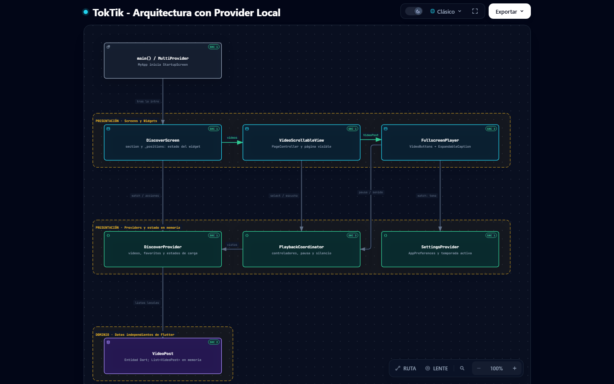
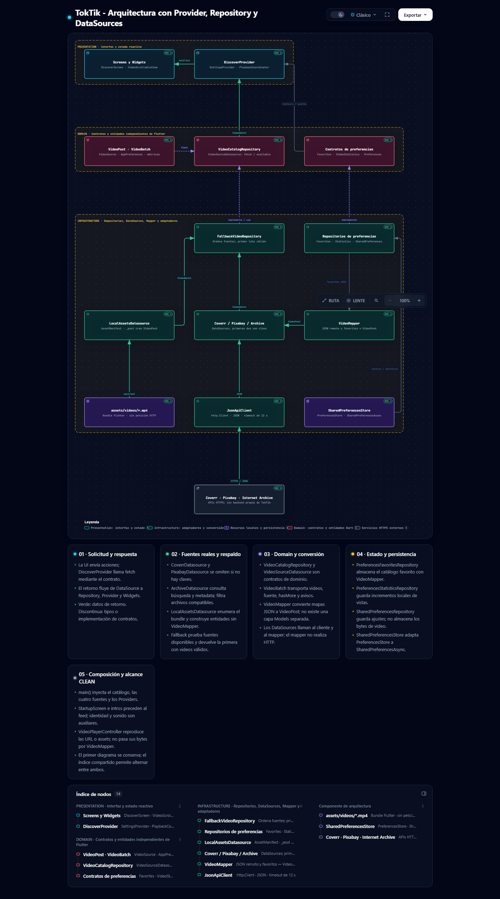

# Práctica 04 · TokTik

**Desarrollo Móvil Integral · Flutter y Dart · Arquitectura CLEAN**

Aplicación de videos cortos con desplazamiento vertical, Discover, For You y
Favorites. Integra reproducción del video visible, favoritos persistentes,
fuentes locales/remotas y cuatro identidades visuales con intro y bienvenida
sonora.

[Menú principal de arquitecturas](../../index.html) ·
[Explorar ambos diagramas](architecture/index.html) ·
[Guía técnica completa](docs/GUIA_TECNICA.md) ·


## Contenido

- [Demostración interactiva de TokTik](#demostración-interactiva-de-toktik)
- [Resumen de funcionalidades](#resumen-de-funcionalidades)
- [Ejecutar TokTik](#ejecutar-toktik)
- [Identidad visual](#identidad-visual)
- [Galería de videos para GitHub Pages](#galería-de-videos-para-github-pages)
- [Videos demostrativos](#videos-demostrativos)
- [Pantallas de carga](#pantallas-de-carga)
- [Diagramas de Arquitectura](#diagramas-de-arquitectura)
- [Organización de evidencias](#organización-de-evidencias)

## Demostración interactiva de TokTik

Appetize permite ejecutar aplicaciones móviles de forma interactiva desde el
navegador. Prueba la versión publicada de TokTik **sin instalar la aplicación**
en tu dispositivo.

**[▶️ Probar TokTik](https://appetize.io/app/b_mxqkb4onsv4c5o2yd546uwzesi)**

## APK release para Appetize

Coverr y Pixabay utilizan un backend HTTPS para que las claves privadas no
queden dentro del APK público. El archivo api_keys.json se reserva para
desarrollo y para el servidor; no se carga automáticamente en release.

Consulta la [guía de configuración, compilación y pruebas reales](docs/APPETIZE_APIS.md)
y el [backend de catálogos](backend/README.md). Primero debe desplegarse el
backend; después el script scripts/build_appetize_release.ps1 genera el APK
con su URL pública y comprueba que no incluya las claves locales.

## Resumen de funcionalidades

| Área | Comportamiento |
| --- | --- |
| Discover | Catálogo ordenado por likes base, sin atribuirle un algoritmo de recomendación inexistente. |
| For You | Scroll vertical, paginación cuando existe y recorrido repetido del catálogo al agotarse. |
| Favorites | Videos guardados con identidad y metadatos persistentes, incluso al cambiar de fuente. |
| Reproducción | Autoplay exclusivo del video visible, pausa, sonido, precarga de vecinos, errores y reintento. Hasta tres controladores en memoria. |
| Interacción | Corazón unificado favorito/me gusta, métricas identificadas cuando son simuladas y descripción expandible. |
| Fuentes | Assets MP4, Internet Archive, Coverr y Pixabay; respaldo ante fuentes no disponibles. Coverr/Pixabay requieren claves. |
| Identidad | Normal, Halloween, Navidad y San Valentín; selección automática por fecha o manual persistente. |
| Bienvenida sonora | MP3 local por tema durante la intro Flutter, una vez por inicio y detenido antes del feed. Independiente del silencio de los videos. |

Los favoritos guardan metadatos y URL, no los
bytes del video remoto. Consulta los límites de red, restauración, contadores y
ciclo de vida en [la guía técnica](docs/GUIA_TECNICA.md).

## Ejecutar TokTik

Desde la raíz del repositorio, en PowerShell:

```powershell
Set-Location .\Practica04\toktik
flutter pub get
flutter devices
flutter run -d emulator-5554
```

Sustituye el ID por el que muestre `flutter devices`. Para web usa
`flutter run -d chrome`. Sin claves se pueden usar los videos locales e Internet
Archive cuando hay conexión. La configuración de APIs y los scripts de entrada
oculta están documentados en [APIs y configuración](docs/GUIA_TECNICA.md#apis-y-configuración).

```powershell
flutter build apk --debug
```

Compilar el APK no requiere ADB ni un emulador. La instalación y el arranque sí.
La causa y solución del antiguo error del launcher están en
[Compilación Android y launcher](docs/GUIA_TECNICA.md#compilación-android-y-launcher).

## Identidad visual

### Logo Normal

**Nombre:** TokTik · Normal. **Descripción:** identidad base sobre fondo oscuro,
con turquesa y acentos rosados; corresponde a la apariencia sin temporada.


### Logo Halloween

**Nombre:** TokTik · Halloween. **Descripción:** variante estacional con naranja,
morado y ambientación nocturna, asociada a la temática de octubre.


### Logo Navidad

**Nombre:** TokTik · Navidad. **Descripción:** identidad sobre verde oscuro,
con dorado y rojo; acompaña la temática navideña de diciembre.


### Logo San Valentín

**Nombre:** TokTik · San Valentín. **Descripción:** variante con tonos rosas,
rojos y la iconografía de corazón de la temática de febrero.


## Galería de videos para GitHub Pages

Los videos están disponibles en una página HTML con reproductores nativos,
controles y carga de metadatos. Al publicar la raíz del repositorio en GitHub
Pages, abre la [galería de TokTik](videos.html).

## Videos demostrativos

### Funcionamiento general de TokTik

Recorrido desde el arranque hasta el feed: identidad activa, carga, contenido y
ajustes.

<figure>
  <video controls playsinline preload="metadata" title="Funcionamiento general de TokTik">
    <source src="docs/evidencias/videos/videoUno.mp4" type="video/mp4">
    Tu navegador no puede reproducir este video.
  </video>
  <figcaption>Funcionamiento general de TokTik.</figcaption>
</figure>


### Navegación entre pantallas y secciones

Muestra Discover, For You, Favorites, el panel de ajustes y la vista previa de
intro. Las tres pestañas pertenecen a `DiscoverScreen`, no a tres Screens
independientes.

<figure>
  <video controls playsinline preload="metadata" title="Navegación entre pantallas y secciones">
    <source src="docs/evidencias/videos/videoDos.mp4" type="video/mp4">
    Tu navegador no puede reproducir este video.
  </video>
  <figcaption>Navegación entre pantallas y secciones.</figcaption>
</figure>

### Reproducción de videos

Demuestra autoplay, scroll, pausa/reanudación, silencio/sonido y comportamiento
al volver del segundo plano. La galería incluye todas las grabaciones que están
disponibles en este momento.


### Funcionalidades principales

Incluye favoritos y persistencia tras reiniciar, descripción expandible,
contadores, selección de fuente, respaldo y cambios de temporada.

<figure>
  <video controls playsinline preload="metadata" title="Funcionalidades principales de TokTik">
    <source src="docs/evidencias/videos/videoTres.mp4" type="video/mp4">
    Tu navegador no puede reproducir este video.
  </video>
  <figcaption>Funcionalidades principales de TokTik.</figcaption>
</figure>

## Pantallas de carga

Cada video debe registrar un inicio real con
la temática seleccionada, animación y sonido de bienvenida, y el paso al feed.

### Splash Screen normal

<figure>
  <video controls playsinline preload="metadata" title="Splash Screen normal de TokTik">
    <source src="docs/evidencias/videos/videoSiete.mp4" type="video/mp4">
    Tu navegador no puede reproducir este video.
  </video>
  <figcaption>Splash Screen normal.</figcaption>
</figure>

### Splash Screen Halloween

<figure>
  <video controls playsinline preload="metadata" title="Splash Screen Halloween de TokTik">
    <source src="docs/evidencias/videos/videoSeis.mp4" type="video/mp4">
    Tu navegador no puede reproducir este video.
  </video>
  <figcaption>Splash Screen Halloween.</figcaption>
</figure>

### Splash Screen Navidad

<figure>
  <video controls playsinline preload="metadata" title="Splash Screen Navidad de TokTik">
    <source src="docs/evidencias/videos/videoCuatro.mp4" type="video/mp4">
    Tu navegador no puede reproducir este video.
  </video>
  <figcaption>Splash Screen Navidad.</figcaption>
</figure>

### Splash Screen San Valentín

<figure>
  <video controls playsinline preload="metadata" title="Splash Screen San Valentín de TokTik">
    <source src="docs/evidencias/videos/videoCinco.mp4" type="video/mp4">
    Tu navegador no puede reproducir este video.
  </video>
  <figcaption>Splash Screen San Valentín.</figcaption>
</figure>

## Diagramas de Arquitectura

Los dos HTML interactivos y sus SVG ya existen. Las capturas para el informe
académico pueden agregarse posteriormente; no se modificaron los diagramas.

### Diagrama 1: Provider Local

Explica Screens, Widgets, Providers y estado en memoria. Distingue el estado
efímero de los Widgets de las entidades y el estado compartido de presentación.




### Diagrama 2: Provider, Repository y DataSources

Organiza Presentation, Domain e Infrastructure y el retorno de datos desde assets,
Coverr, Pixabay e Internet Archive, pasando por repositorios y Providers hasta la
interfaz. Incluye contratos, mapper y persistencia; no inventa una capa Models.




[Navegar entre ambos diagramas →](architecture/index.html) ·
[Índice de arquitectura e historial](architecture/README.md)

Los esquemas Mermaid, el árbol de `lib/` y los detalles de dependencias se
conservan en [Arquitectura CLEAN](docs/GUIA_TECNICA.md#arquitectura-clean).

## Organización de evidencias

```text
docs/
├── GUIA_TECNICA.md
└── evidencias/
    ├── README.md       # Inventario, nombres previstos y ejemplos de inserción
    ├── logos/          # Cuatro capturas de identidad visual
    ├── videos/         # Cuatro demostraciones de funcionamiento
    ├── splash/         # Cuatro grabaciones de intro con sonido
    └── diagramas/      # Dos capturas de los diagramas Archify
```
