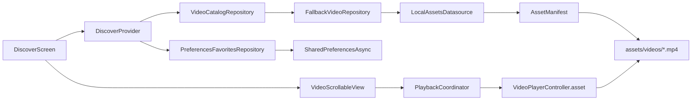
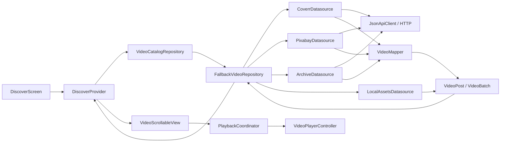

# TokTik · Guía técnica

[Volver al README de TokTik →](../README.md)

Esta guía reúne la información técnica del README anterior: entorno, arquitectura,
APIs, ejecución, persistencia y registros de validación. Las pruebas históricas
conservan sus fechas y limitaciones; no se presentan como nuevas ejecuciones.
Los comandos se ejecutan desde `Practica04/toktik`, salvo indicación contraria.

## Índice

- [Entorno y dependencias](#entorno-y-dependencias)
- [Arquitectura CLEAN](#arquitectura-clean)
- [APIs y configuración](#apis-y-configuración)
- [Persistencia y temporadas](#persistencia-y-temporadas)
- [Compilación Android y launcher](#compilación-android-y-launcher)
- [Registro de revisión del 13 de octubre de 2026](#registro-de-revisión-del-13-de-octubre-de-2026)

## Entorno y dependencias

SDK registrado en la revisión técnica anterior: **Flutter 3.47.4**, **Dart 3.13.3**, canal stable. Restricción Dart del proyecto: `^3.13.2`. `pubspec.lock` conserva las versiones resueltas para esta aplicación.

| Paquete | Versión resuelta | Responsabilidad |
|---|---|---|
| provider | 6.1.5+1 | Estado reactivo e inyección de dependencias |
| video_player | 2.14.1 | Videos, loop, volumen y controladores |
| http | 1.6.0 | Peticiones a las APIs |
| shared_preferences | 2.5.6 | Preferencias y favoritos con API asíncrona |
| audioplayers | 6.8.1 | Audio de bienvenida e intros |
| intl | 0.20.3 | Formato compacto de contadores |
| animate_do | 4.2.0 | Dependencia conservada de la base; transiciones actuales con Flutter |

También se conservan los iconos Cupertino de la base y `flutter_lints`. Las versiones se resolvieron mediante `flutter pub get`; el APK debug compiló e instaló en el emulador disponible. La comprobación de reproducción en frío sigue pendiente, descrita abajo.


## Funcionalidades

- **Discover:** catálogo disponible ordenado por likes base; no inventa un sistema de recomendación.
- **For You:** PageView vertical, carga adicional cerca del final cuando la fuente tiene más páginas y recorrido repetido del catálogo cuando se agota.
- **Favorites:** conserva videos guardados aunque se cambie de fuente, gracias a identificadores estables y metadatos persistentes.
- Autoplay exclusivo del video visible, loop, toque para pausar/reanudar, botón de sonido y máximo de tres controladores en memoria.
- Precarga de vecinos, liberación de controladores fuera de la ventana, estados de carga, errores y reintento. La inicialización del reproductor tiene un límite de 60 segundos; una fuente de catálogo tiene un límite total de 20 segundos y cada solicitud HTTP, de 12 segundos.
- Pausa inmediata al cambiar de sección o pasar a segundo plano. Una pausa manual se respeta al regresar a primer plano.
- Corazón unificado para favorito/me gusta: suma exactamente uno al contador base y lo resta al desmarcar. No modifica los contadores del servidor.
- Descripción limitada a dos líneas; “Ver más” y “Ver menos” sólo cuando el texto excede ese espacio. El desplazamiento interno se activa únicamente en el panel expandido.
- Fuente, creador y licencia cuando se proporcionan. Los videos sin estadísticas reciben métricas simuladas deterministas, identificadas como demostración en los tooltips. Las vistas base dejan margen para el like del usuario. Las métricas recibidas de las APIs se conservan cuando son coherentes.
- Selector de fuente, regreso explícito a Aleatoria, temporadas automáticas/manuales y sonido de bienvenida opcional (el ambiente anterior está deshabilitado).
- Interfaz oscura, superposiciones, gradientes, transiciones y navegación con áreas seguras. Los selectores se validaron a 320 × 640 y los controles de video a 640 × 320 mediante pruebas de widgets.


## Arquitectura CLEAN

### Flujo local del catálogo (esquema técnico)

Con la fuente local seleccionada, el Provider conserva estado y favoritos; el repositorio localiza los MP4 del bundle y el coordinador administra el reproductor del elemento visible.



### Flujo con múltiples fuentes (esquema técnico)

El mismo contrato permite alternar fuentes. El repositorio prueba la seleccionada, valida y deduplica resultados, y continúa con fuentes disponibles si no obtiene videos reproducibles.



```text
lib/
├── main.dart                          # Composición e inyección
├── config/
│   ├── api/api_config.dart            # dart-define y límites HTTP
│   ├── helpers/                       # Formato de números
│   └── theme/                         # Colores, iconos, tipografía y tiempos
├── domain/
│   ├── entities/                      # VideoPost, VideoBatch, fuente y temporada
│   ├── datasources/                   # Contrato de fuentes y errores
│   └── repositories/                  # Catálogo, favoritos, preferencias, audio
├── infrastructure/
│   ├── datasources/                   # Coverr, Pixabay, Archive y assets
│   ├── mappers/                       # Respuestas JSON ↔ VideoPost
│   ├── repositories/                  # Respaldo, persistencia y audioplayers
│   └── storage/                       # Adaptador SharedPreferencesAsync
└── presentation/
    ├── providers/                     # Discover, Settings, Playback, ThemeAudio
    ├── screens/discover/              # Tres secciones del feed
    ├── shared/                        # PageView y acciones
    └── widgets/                       # Ajustes, reproductor y descripción
```

El dominio utiliza Dart puro y no importa Flutter ni plugins. Los widgets no procesan respuestas HTTP. Los repositorios y datasources se inyectan; el cliente HTTP compartido se cierra al liberar la aplicación. Las tres secciones pertenecen a una pantalla; no se creó una carpeta de router vacía.

El repositorio prueba primero la fuente seleccionada, omite fuentes sin credenciales, rechaza URLs incompatibles, descarta resultados incompletos y deduplica por ID. Si no obtiene contenido, intenta las otras fuentes. Aleatoria mezcla el orden de consulta. La UI muestra la fuente efectiva; los motivos del respaldo están en **Fuentes y temas → Estado de las fuentes**. Si todas fallan, muestra un estado sin contenido y permite cambiar la fuente o reintentar.

La validación del catálogo comprueba estructura, URL y formato declarado; la compatibilidad definitiva del decodificador se comprueba al inicializar `video_player`. Una respuesta HTTP correcta no garantiza que todos sus videos se puedan reproducir.

## APIs y configuración

Las claves se leen exclusivamente en `lib/config/api/api_config.dart` mediante `String.fromEnvironment`. No hay claves reales versionadas.

| Fuente | Endpoint y procesamiento |
|---|---|
| Coverr | `https://api.coverr.co/videos`, Bearer, páginas desde 0 y `urls=true`; convierte `hits` y `urls.mp4_preview`/`urls.mp4` |
| Pixabay | `https://pixabay.com/api/videos/`, parámetro `key`, páginas desde 1 y safesearch; selecciona una variante MP4 válida de `videos` |
| Internet Archive | `https://archive.org/advancedsearch.php` para buscar IDs y `https://archive.org/metadata/{identifier}` para localizar MP4; URL de descarga formada a partir del nombre real del archivo |
| Videos locales | Descubre MP4 existentes en `assets/videos/` mediante AssetManifest |

Referencias de los contratos HTTP: [Coverr (videos)](https://api.coverr.co/docs/videos/), [Coverr (autenticación)](https://api.coverr.co/docs/auth/), [Pixabay](https://pixabay.com/api/docs/), [búsqueda de Internet Archive](https://doc-tools.readthedocs.io/en/ia-test-gsod/item-search-apis.html) y [metadatos de Internet Archive](https://archive.org/developers/md-read.html).

Internet Archive busca material con licencia declarada CC0 o CC BY 4.0; procesa dos consultas de metadatos a la vez, omite archivos privados, H.265 declarado y archivos mayores de 80 MB, y elige una variante por ítem. La atribución y licencia recibidas se conservan. Una declaración del uploader no sustituye revisar los derechos antes de redistribuir contenido. Coverr exige respetar sus condiciones de atribución; antes de publicar una integración habilitada con clave, completa y verifica su atribución visual oficial.

Las peticiones usan timeout de 12 segundos. HTTP no exitoso, JSON inválido, respuestas vacías y falta de claves producen respaldo o un mensaje claro, sin mostrar claves ni trazas internas. No se simulan respuestas en la aplicación. Las respuestas sintéticas se utilizan exclusivamente en pruebas unitarias.

### Instalación y ejecución en PowerShell

Desde la raíz del repositorio:

```powershell
Set-Location .\Practica04\toktik
flutter --version
flutter pub get
flutter devices
flutter run
```

Sin claves funcionan Videos locales e Internet Archive cuando hay conexión. Para probar localmente sin Android:

```powershell
flutter run -d chrome
```

Para guardar las claves localmente, ejecuta este script y escríbelas cuando PowerShell las solicite. La entrada no se muestra y `api_keys.json` está excluido de Git:

```powershell
.\scripts\save_api_keys.ps1
```

Después, inicia la app pasando el archivo al compilador:

```powershell
flutter run -d emulator-5554 --dart-define-from-file=api_keys.json
```

`api_keys.json` está ignorado por Git. Aun así, `--dart-define-from-file` no protege las claves dentro de un binario distribuido; para producción, usa un backend intermediario y revisa las condiciones de las cuentas. Reinicia la ejecución al cambiar los defines.

También puedes usar el lanzador con entrada oculta de PowerShell; no guarda las claves en un archivo:

```powershell
.\scripts\run_with_api_keys.ps1 -Device chrome
```

### Videos locales y audio original

Se incluyen tres loops verticales H.264 de 360 × 640 y seis segundos sin pista de audio, y tres secuencias WAV de tonos originales. Para comprobar sonido de video utiliza un MP4 con audio; los sonidos de temporadas e intros tienen sus propias pistas. Su creación está documentada en [assets/LICENSE.md](../assets/LICENSE.md). No se descargó música ni se copió contenido visual de terceros para el respaldo.

Agrega tus propios MP4 autorizados en `assets/videos/` y ejecuta nuevamente `flutter pub get`/`flutter run`. La carpeta ya está declarada; los archivos se descubren automáticamente. Los archivos distintos a los tres originales se identifican como videos locales sin atribución o licencia inventada. Los archivos locales también deben ser compatibles con el dispositivo.

La regeneración es opcional; los recursos ya están incluidos. Requiere Python y FFmpeg con libx264:

```powershell
python .\scripts\generate_resources.py --ffmpeg "C:\ruta\a\ffmpeg.exe"
```

## Persistencia y temporadas

SharedPreferencesAsync guarda JSON en tres claves:

- `toktik.favorite_catalog.v2`: IDs, metadatos y URL de los favoritos; el me gusta se deriva del estado de favorito. Una escritura guarda ambos estados juntos.
- `toktik.view_increments.v1`: incrementos de vistas persistentes. Sólo se cuenta progreso real de reproducción durante tres segundos, una vez por video y sesión; reconstruir o volver a una sección no suma vistas.
- `toktik.preferences.v1`: fuente seleccionada, temporada manual o null para Automático, silencio y audio temático.

Se pueden leer los IDs de la implementación anterior (`toktik.favorites.v1`) para migrarlos cuando el video vuelve a aparecer. v2 es autoritativa, incluso vacía. Los errores de escritura de favoritos restauran el estado anterior; una preferencia fallida no reemplaza el último valor guardado. Cambiar la URL de un archivo local cambia su identidad. Las URLs remotas pueden caducar; un favorito guarda metadatos, no descarga el video ni garantiza disponibilidad offline.

| Tema automático | Periodo | Apariencia |
|---|---|---|
| Halloween | Todo octubre | Negro, naranja, morado y luna |
| Navidad | Todo diciembre | Verde, rojo, dorado y árbol |
| San Valentín | 1–14 de febrero | Rosa, rojo y corazón |
| Normal | Resto del año | Oscuro y turquesa |

La fecha se revisa al volver a primer plano y a medianoche local. La selección manual prevalece hasta elegir Automático y se conserva tras reiniciar. Los temas cambian la paleta, iconografía, familia tipográfica y duración de las animaciones; la tipografía concreta depende de las fuentes del sistema.

El audio ambiental anterior está deshabilitado, incluso si una preferencia antigua
lo tenía activado. Silenciar o pausar un video ya no inicia sonidos de temporada.
Se conserva la coordinación con `PlaybackCoordinator` y los controles del video.

El sonido de bienvenida usa MP3 locales opcionales en `assets/sounds/`:

| Tema | Archivo |
| --- | --- |
| Normal | `normal.mp3` |
| Halloween | `halloween.mp3` |
| Navidad | `christmas.mp3` |
| San Valentín | `valentine.mp3` |

Los MP3 no se generaron durante la implementación del sistema. En el árbol actual
ya existen los cuatro archivos; su presencia no certifica su reproducción en dispositivo. El directorio completo está registrado como
asset; ningún archivo individual es obligatorio. Tras colocarlos, reinicia la
ejecución de Flutter para empaquetarlos. El repositorio verifica el manifiesto de
assets antes de crear el reproductor y omite archivos ausentes o no reproducibles.

El splash Android permanece intacto. Al aparecer la intro Flutter, después de
restaurar la temática elegida o calcularla por fecha, `IntroAudioProvider` solicita
la pista una sola vez por inicio, sin bucle. Se detiene antes de mostrar el feed,
al abandonar la pantalla o al pasar a segundo plano; reanudar no la reinicia.
Está habilitada por defecto y es independiente del silencio del video; una
preferencia explícita desactivada se conserva. Ajustes permite desactivarla y
abrir una vista previa explícita de la intro. Las pistas WAV anteriores ya no se
usan para la bienvenida ni para reproducir ambiente durante pausas.

## Compilación Android y launcher

La compilación no consulta ADB ni prepara dispositivos: `flutter build apk --debug`
genera `build/app/outputs/flutter-apk/app-debug.apk` aunque no haya un emulador
disponible. La instalación y el arranque son pasos separados y sí requieren ADB.
Se retiró de `assembleDebug` el bloque personalizado que detenía la app instalada
y abría `LauncherPreparationActivity`; un timeout de ese bloque causaba el error
«ADB no respondió al preparar el launcher debug» después de generar el APK.

Si una instalación anterior dejó deshabilitada la entrada normal al elegir un
icono de temporada, el helper sigue disponible como herramienta de desarrollo:
`./scripts/prepare_android_launcher.ps1 -Device emulator-5554` (requiere un APK
debug instalado y ADB operativo). No es un requisito de compilación.
`LauncherActivity` redirige a `MainActivity`, que permanece habilitada; para
comprobar directamente el arranque se puede usar
`adb -s emulator-5554 shell am start -W -n com.example.toktik/.MainActivity`.
Los alias, iconos, intros y preferencias de temporada se conservan.

Validación de esta corrección (15 de octubre de 2026): `flutter analyze` sin
observaciones; `flutter test` con 54 aprobadas y 2 omitidas por requerir claves
de APIs. `flutter build apk --debug` y una repetición con
`ADB_SERVER_SOCKET=tcp:127.0.0.1:1` terminaron correctamente. En
`emulator-5554` (API 35), la instalación con `adb install -r` fue rechazada por
espacio interno insuficiente (456 MB disponibles); liberar cachés no lo resolvió.
La copia previamente instalada abrió mediante `MainActivity` y quedó en primer
plano. Falta verificar el arranque del APK nuevo cuando haya espacio disponible.

## Registro de revisión del 13 de octubre de 2026

Se conservan la arquitectura CLEAN, Provider, las tres secciones, los temas y el diseño existente. No se agregaron dependencias ni se modificaron otras prácticas.

Correcciones de esta revisión:

- Los controles de favorito y sonido se disponen horizontalmente en orientación horizontal para mantenerlos visibles y pulsables. El diseño vertical se conserva; la prueba de 640 × 320 verifica ambos botones.
- Los reproductores de audio se crean sólo al solicitar una pista. Detener audio nunca iniciado no bloquea el splash ni consume un reproductor nativo.
- Los callbacks de video espaciados cuentan progreso acotado; una restauración fallida permite reintentar el registro de vistas sin marcarlo como completado ni sobrescribir datos previos.
- Favorites distingue una lectura fallida de una colección vacía y ofrece reintento de lectura.
- Una inicialización nativa que termina después del timeout se recupera automáticamente; no se precargan otros decodificadores mientras el video visible está en error.
- Si falla la restauración inicial, se reintenta antes de modificar favoritos o vistas. No se sobrescriben datos aún no recuperados; se eliminaron lecturas duplicadas de favoritos.
- Una URL renovada para un mismo ID sustituye y libera el controlador anterior.
- Antecedente posteriormente sustituido por la corrección del 15 de octubre: se amplió la espera acotada del preparador del launcher debug: en el emulador Android 17 se observó un arranque de aproximadamente 67 segundos. Se comprobó que el helper habilita `LauncherActivity`; no modifica preferencias ni el APK release.
- El reintento es seguro cuando el feed ya está vacío o el coordinador fue cerrado; los índices se limitan al catálogo.
- La paginación termina si una página no aporta nuevos videos, evitando peticiones repetidas sin avance.
- Cada fuente tiene un límite total de 20 segundos antes de continuar con el respaldo, incluido Internet Archive con sus múltiples solicitudes.
- Los selectores reflejan el estado persistido al regresar a Aleatoria y después de errores de escritura; el panel actualiza los avisos de las fuentes.
- Las vistas conservan margen sobre los likes incluso tras el +1 del usuario, sin sumar vistas por dar like.

### Ejecutar las validaciones

Desde `Practica04/toktik`, ejecuta estos comandos secuencialmente. No ejecutes pruebas y compilación Android simultáneamente: Flutter regenera el registro de plugins y puede incluir `integration_test` durante una compilación release que lo excluye.

```powershell
flutter pub get
flutter analyze
flutter test
flutter build apk --release
```

Resultados registrados en esa revisión (históricos):

- `flutter pub get`: correcto, sin nuevas dependencias.
- `flutter analyze`: sin incidencias.
- `flutter test`: 54 pruebas aprobadas y 2 omitidas de APIs autenticadas.
- Pruebas unitarias/widgets: navegación de las tres secciones con reproductores simulados, favoritos y contadores persistentes con almacenamiento de prueba, progreso real deduplicado, pausa/lifecycle, liberación de controladores, respaldo de fuentes, selectores a 320 × 640, calendario y persistencia de temporadas, logos, intros y coordinación de audio.
- Internet Archive: consulta real y metadatos de seis resultados recuperados; informe en [docs/live_archive_probe.json](live_archive_probe.json). La consulta no demuestra decodificación ni reproducción de los MP4 remotos.
- Coverr/Pixabay: contratos HTTP y mapeo comprobados mediante fixtures sintéticos explícitos; sus pruebas autenticadas están omitidas. No se usaron ni se mostraron claves privadas.
- `flutter build apk --release`: correcto; APK generado (50,3 MB reportados por Flutter). Una primera ejecución simultánea con las pruebas falló por el registro generado de `integration_test`; la ejecución secuencial terminó correctamente.
- `season_identity_test.dart` en Android 17 / API 37: aprobada. Verifica los cuatro estados de launcher, preferencias guardadas y pausa/reanudación del video real. ADB informó timeout al desinstalar el APK de prueba durante la limpieza; el runner terminó con código 0.
- `feed_statistics_test.dart`: una ejecución llegó a comprobar inicialización y autoplay, pero falló al esperar el +1 de vistas. Se corrigieron el muestreo de progreso y el reintento de registro; sus regresiones pasan en la suite de escritorio. La última repetición nativa quedó bloqueada antes de arrancar: ADB no respondió al helper debug dentro de 90 segundos. **La prueba completa del feed Android no está aprobada.** Repetirla en un AVD limpio o dispositivo físico antes de publicar; tampoco se considera verificada la restauración en frío de favoritos, que mostró un error durante una ejecución previa.

### APK para Appetize

```powershell
flutter build apk --release
```

APK generado: `build/app/outputs/flutter-apk/app-release.apk` (52,727,399 bytes). Se inspeccionó el paquete: incluye `armeabi-v7a`, `arm64-v8a`, `x86_64` y los tres MP4 locales. SHA-256: `43B9B530418E11BD1BBE1C885F55156FBC3EB1533414E840DAB3A07BC7917779`. Los videos locales permiten probar sin claves de API; selecciona **Videos locales** en ajustes.

La configuración actual firma release con la clave debug. Para una futura distribución en tiendas configura un identificador definitivo y firma propia. No se publicó ni se subió a Appetize durante esta revisión.

Las claves son opcionales. Si utilizas un archivo local de defines, mantenlo fuera del repositorio. Los valores de `--dart-define` se incorporan al binario y no constituyen almacenamiento seguro de secretos; para distribuir credenciales privadas utiliza un backend propio. Los favoritos guardan metadatos y URL, no descargan los videos remotos; una URL puede caducar.

### Pruebas manuales antes de publicar

Confirma en dispositivo físico y posteriormente en Appetize: arranque en frío, autoplay y scroll rápido en las tres secciones, pausa y sonido, cierre/reinicio con favoritos y preferencias, eliminación del último favorito, segundo plano, cuatro intros y sonidos, iconos del launcher, orientación horizontal, texto grande, pérdida de red, reintento y reproducción de cada fuente remota con credenciales autorizadas.

Pruebas nativas disponibles:

```powershell
flutter devices
flutter test integration_test/feed_statistics_test.dart -d emulator-5554
flutter test integration_test/season_identity_test.dart -d emulator-5554
```

Cambia el ID según `flutter devices`. Las pruebas Android no se ejecutan dentro de la suite normal de `flutter test`. `video_player` no ofrece reproducción nativa Windows/Linux en esta configuración; utiliza Android, iOS o web. La compilación iOS requiere macOS.

Las pruebas autenticadas son optativas y sólo deben ejecutarse con credenciales autorizadas:

```powershell
flutter test test/live_sources_test.dart `
  --dart-define=RUN_LIVE_APIS=true `
  --dart-define="COVERR_API_KEY=$env:COVERR_API_KEY" `
  --dart-define="PIXABAY_API_KEY=$env:PIXABAY_API_KEY"
```

No se realizaron commits, merges ni pushes. El [inventario histórico](CHANGES.md) describe trabajo anterior; los resultados de esta sección corresponden a aquella revisión, no a una ejecución nueva de esta documentación.

## Validaciones posteriores registradas

Tras preparar la identidad sonora MP3, se registraron `flutter analyze` sin
observaciones y `flutter test` con 60 aprobadas y 2 omitidas por credenciales.
Esto no sustituye las pruebas nativas pendientes ni certifica los MP3 añadidos
posteriormente. La revisión de documentación no ejecuta ni modifica Flutter.

Los diagramas Archify y sus recibos se conservan en [el índice de arquitectura](../architecture/README.md).
