# Práctica 05 – Widgets App

Aplicación académica de **Desarrollo Móvil Integral**, desarrollada con Flutter y Dart para explorar componentes visuales e interactivos de Material Design 3. Proyecto existente integrado en la rama `main` del [repositorio Practicas_DMI_230881](https://github.com/Ktmich2095/Practicas_DMI_230881). Se conservan sus once pantallas, las 19 capturas reales y las 12 pruebas.

## Objetivo

Demostrar widgets de Material 3 mediante un catálogo navegable, navegación declarativa con GoRouter y administración reactiva del contador y los temas con Riverpod. Incluye botones, tarjetas, indicadores, diálogos, animaciones, controles, tutorial, lista infinita y Pull to Refresh.

## Tecnologías y versiones comprobadas

| Tecnología | Versión / configuración |
|---|---|
| Flutter | 3.35.6, canal stable |
| Dart | 3.9.2; requisito SDK ^3.9.2 |
| flutter_riverpod | 2.6.1 |
| go_router | 17.2.3 |
| animate_do | 4.2.0 |
| flutter_lints | 5.0.0 |
| Material Design | 3, ColorScheme generado desde el color elegido |
| Gradle / Android Gradle Plugin | 8.14 / 8.11.1 |
| Kotlin | 2.2.20 |
| Java del daemon Gradle | JDK 21.0.11, seleccionado solo para el proceso |
| Android NDK / CMake | 27.0.12077973 / 3.22.1, instalados para completar el APK |

`pubspec.lock` fija la resolución compatible. Riverpod 2.6.1 expone **StateProvider, StateNotifierProvider y StateNotifier** desde `flutter_riverpod.dart`; no requiere importaciones legacy. Se conservan las APIs académicas y `ProviderScope`, `ConsumerWidget`, `ref.watch()` y `ref.read()`. Los radios usan RadioGroup con RadioListTile, compatible con Flutter instalado. No se migró a Riverpod 3.

## Arquitectura y estructura

```text
lib/
  main.dart                      ProviderScope y MaterialApp.router
  config/
    menu/menu_items.dart         Catálogo compartido por inicio y drawer
    router/app_router.dart       Rutas y recuperación de ruta desconocida
    theme/app_theme.dart         AppTheme, ColorScheme, colores y brillo
  presentation/
    screens/                     Once pantallas por funcionalidad
    providers/                   counterProvider y ThemeNotifier
    widgets/                     SideMenu y RemoteImage
assets/images/                   Tres PNG del tutorial y GIF local de carga
test/widget_test.dart            12 pruebas automatizadas
integration_test/                Pruebas opcionales de imágenes HTTPS reales
docs/diagrams/                   Dos visores Archify y fuentes JSON editables
docs/evidence/                   Capturas, recibos y registros; se conservan los históricos
docs/evidence/delivery-20261109/  Resultados de esta revalidación
tool/                           Herramientas de capturas y verificación de Pages
```

Se conserva `presentation/` como contenedor de screens, providers y widgets. GoRouter construye las pantallas. MainApp observa ThemeNotifier y aplica AppTheme a toda la aplicación. El contador y tema viven en memoria durante la sesión, sin persistencia al reiniciar. Tarjetas y galería comparten RemoteImage con carga, error y reintento. La paginación simula latencia mediante Future.delayed; las fotos se descargan por HTTPS real, sin backend propio.

## Instalación y ejecución

Con Flutter y el SDK Android configurados, desde `Practica05/widgets_app` en la rama `main`:

```powershell
flutter pub get
flutter run
flutter analyze
flutter test
flutter build apk --release
```

Para web: `flutter build web --no-web-resources-cdn --no-wasm-dry-run`. Se requiere red para instalar dependencias y descargar fotos; el tutorial usa assets locales declarados en pubspec.yaml. Android declara INTERNET en el manifiesto principal.

En este equipo Flutter identifica Java 25 de Android Studio. Se seleccionó JDK 21 para el daemon Gradle sin cambiar la configuración global:

```powershell
$env:GRADLE_OPTS='"-Dorg.gradle.java.home=C:/Program Files/Java/jdk-21.0.11"'
flutter build apk --release
```

Adaptar la ruta en otros equipos. Se conserva Gradle 8.14. La descarga Java de esa distribución se detuvo; se descargó el mismo ZIP oficial con otro cliente y se verificó su SHA-256 antes de colocarlo en la caché. [Registro](docs/evidence/delivery-20261109/gradle-download.json). No se cambiaron versiones para ocultar errores. La configuración existente fija NDK 27.0.12077973: se instaló su archivo oficial comprobando tamaño y checksum contra el catálogo de Google. Gradle instaló CMake 3.22.1 usando las licencias ya disponibles en el SDK. No se aceptaron licencias mediante respuestas automáticas a un asistente.

## Pantallas implementadas

| Ruta | Pantalla y demostración |
|---|---|
| / | HomeScreen: catálogo, Scaffold, AppBar y menú lateral |
| /counter-river | CounterScreen: incrementar, disminuir, reiniciar al valor inicial 5 y alternar tema |
| /buttons | ButtonsScreen: variantes Material, botones deshabilitados y personalizado |
| /cards | CardsScreen: elevaciones, bordes, colores e imágenes remotas |
| /progress | ProgressScreen: indicadores determinados e indeterminados con Stream |
| /snackbars | SnackbarScreen: SnackBar, confirmación y AboutDialog |
| /animated | AnimatedScreen: dimensiones, colores y bordes aleatorios |
| /ui-controls | UiControlsScreen: switch, radios, checkboxes y expansión |
| /tutorial | AppTutorialScreen: tres páginas locales, anterior, siguiente, comenzar y salir |
| /infinite | InfiniteScrollScreen: paginación, refresco y regreso al inicio |
| /theme-changer | ThemeChangerScreen: nueve colores y modo claro/oscuro |

Inicio y drawer usan `context.push()`. El tutorial usa `context.pop()` cuando existe una ruta anterior y vuelve al inicio en acceso directo. Las fotos se agregan de cinco en cinco; se bloquean cargas duplicadas, se descartan respuestas anteriores al refrescar y se comprueba mounted después de operaciones asíncronas.

## Tabla de los 20 requisitos

Estados basados en el código inspeccionado y las evidencias indicadas. Pages y el enlace de Appetize responden HTTP 200.

| Nº | Requisito | Estado | Archivo(s) | Evidencia |
|---|---|---|---|---|
| 01 | Configuración inicial | COMPLETO | pubspec.yaml, pubspec.lock, assets/images/ | pub get aprobado; Flutter 3.35.6 y Dart 3.9.2 compatibles |
| 02 | Arquitectura modular | COMPLETO | lib/config/, lib/presentation/{screens,providers,widgets}/ | Estructura conservada e inspeccionada |
| 03 | Material Design 3 | COMPLETO | config/theme/app_theme.dart | AppTheme, ColorScheme, claro/oscuro y prueba del tema global |
| 04 | GoRouter | COMPLETO | config/router/app_router.dart, main.dart | Pruebas de todas las rutas y push/pop |
| 05 | Pantalla principal | COMPLETO | screens/home/home_screen.dart | Scaffold, AppBar, ListView.builder y ListTile; captura 01 |
| 06 | Menú lateral | COMPLETO | widgets/side_menu.dart, config/menu/menu_items.dart | Catálogo central, NavigationDrawer agrupado y prueba de navegación; captura 13 |
| 07 | Botones | COMPLETO | screens/buttons/buttons_screen.dart | Variantes Material, deshabilitados, Material/InkWell; prueba de acción; captura 03 |
| 08 | Tarjetas | COMPLETO | screens/cards/cards_screen.dart, widgets/remote_image.dart | Elevaciones, borde, color y fotos HTTPS visibles en captura 04-tarjetas-imagenes |
| 09 | Indicadores de progreso | COMPLETO | screens/progress/progress_screen.dart | Stream.periodic y StreamBuilder; prueba que completa en 1.0 |
| 10 | Notificaciones y diálogos | COMPLETO | screens/snackbar/snackbar_screen.dart | SnackBar, AlertDialog, AboutDialog y pruebas de apertura/cierre |
| 11 | Animaciones | COMPLETO | screens/animated/animated_screen.dart | StatefulWidget, AnimatedContainer y azar; prueba a 480×320 |
| 12 | Controles interactivos | COMPLETO | screens/ui_controls/ui_controls_screen.dart | Switch, Radio, Checkbox, ExpansionTile, enum y setState; prueba interactiva |
| 13 | Tutorial introductorio | COMPLETO | screens/app_tutorial/app_tutorial_screen.dart, assets/images/ | PageView, PageController, PNG, FadeInRight, anterior/siguiente/finalizar; prueba a 320×640 |
| 14 | Lista infinita | COMPLETO | screens/infinite_scroll/infinite_scroll_screen.dart, widgets/remote_image.dart | ScrollController, paginación, FadeInImage, NetworkImage, GIF; prueba de desmontaje |
| 15 | Pull to Refresh | COMPLETO | screens/infinite_scroll/infinite_scroll_screen.dart | RefreshIndicator; pruebas de renovación de IDs y descarte de carga anterior |
| 16 | Contador con Riverpod | COMPLETO | providers/counter_provider.dart, screens/counter/counter_screen.dart | StateProvider, ConsumerWidget, watch/read; incrementar, disminuir y reiniciar a 5 probados |
| 17 | Tema dinámico con Riverpod | COMPLETO | providers/theme_provider.dart, screens/theme_changer/theme_changer_screen.dart | StateNotifierProvider, ThemeNotifier y RadioListTile; color/brillo global probados |
| 18 | Pruebas | PARCIAL | test/widget_test.dart, integration_test/remote_images_test.dart, docs/evidence/ | 12 pruebas automatizadas, análisis sin incidencias y compilación release aprobados |
| 19 | Arquitectura con Archify | COMPLETO | docs/diagrams/general.html, especifica.html y *.archify.json | Dos visores, zoom y fuentes JSON comprobados; URLs públicas HTTP 200 |
| 20 | Documentación y publicación | COMPLETO | README.md, docs/index.html, docs/APPETIZE.md | README académico y 19 capturas conservadas; Pages y enlace Appetize HTTP 200 |

## Resultados reales de comandos

Revalidación: **9 de noviembre de 2026**, Windows, rama `main`.

| Comando | Resultado | Registro |
|---|---|---|
| flutter doctor -v | Flutter/Dart disponibles; incidencia Android: licencias con estado desconocido | [doctor.txt](docs/evidence/delivery-20261109/doctor.txt) |
| flutter pub get | Aprobado, salida 0; versiones más nuevas disponibles no son errores | [pub-get.txt](docs/evidence/delivery-20261109/pub-get.txt) |
| flutter analyze | Aprobado, salida 0, No issues found | [analyze.txt](docs/evidence/delivery-20261109/analyze.txt) |
| flutter test --reporter expanded | Aprobado, salida 0, **12 pruebas** | [tests.txt](docs/evidence/delivery-20261109/tests.txt) |
| flutter build apk --release | APROBADO, salida 0; APK release generado y comprobado. | [Resultado de compilación](docs/evidence/delivery-20261109/build-outcome.json) |
| node tool/check_practice05_site.mjs | Aprobado: 8 comprobaciones de página y 100 enlaces, a 390/1440 px; visores y zoom funcionales | [site-check.json](docs/evidence/screenshots/site-check.json) |

APK release generado y verificado: `build/app/outputs/flutter-apk/app-release.apk`. Tamaño: **48,686,330 bytes (46.43 MiB)**. ABI incluidas: arm64-v8a, armeabi-v7a, x86_64. SHA-256: `a8e48cd46c6d82991315218dd25d994dcaf147935e78972534ce2e1771970191`. [Manifiesto del APK](docs/evidence/delivery-20261109/apk-release.json). El binario está en build/, excluido de Git; no se publica automáticamente. La variante release conserva la firma de depuración existente para esta demostración académica; no se preparó una firma de producción para Play Store.

## Alcance de las verificaciones

**Automatizadas en flutter_test:** navegación de las diez rutas del menú más el inicio, drawer, botones, las tres operaciones del contador, tema global, progreso hasta 1.0, controles, diálogos, tutorial a 320×640, animación a 480×320, error/reintento de imagen, paginación, refresco concurrente y desmontaje durante una petición. flutter_test usa HTTP simulado; no acredita disponibilidad del servidor remoto.

**Automatizadas en Chrome:** menú y portal bajo `/Practicas_DMI_230881/`, fuentes e imágenes enlazadas, visores Archify y zoom, sin overflow en los anchos comprobados. **Revisión visual:** las 19 capturas web preexistentes son reales y se conservan; las fotos finales de tarjetas y galería estaban descargadas en Chrome.

## Las 19 capturas reales

Capturas web de Chrome a **430×932**. Se mantienen los archivos y enlaces existentes; no se borraron ni se reemplazaron con imágenes generadas.

| Pantalla | Pantalla | Pantalla |
|---|---|---|
| **Inicio**<br>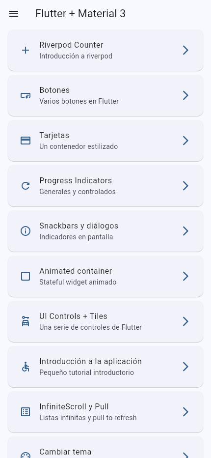 | **Contador Riverpod**<br>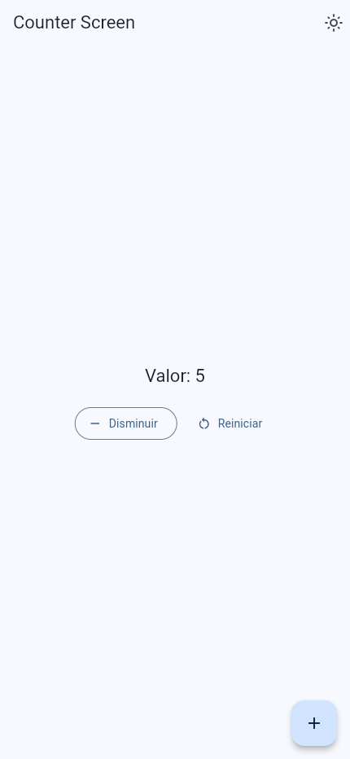 | **Botones**<br>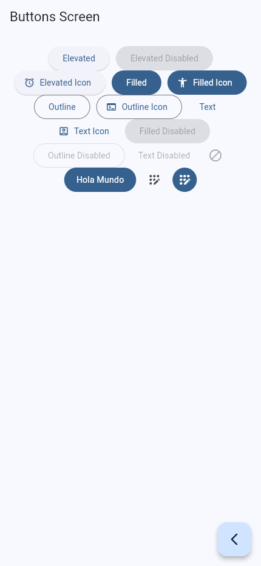 |
| **Tarjetas**<br>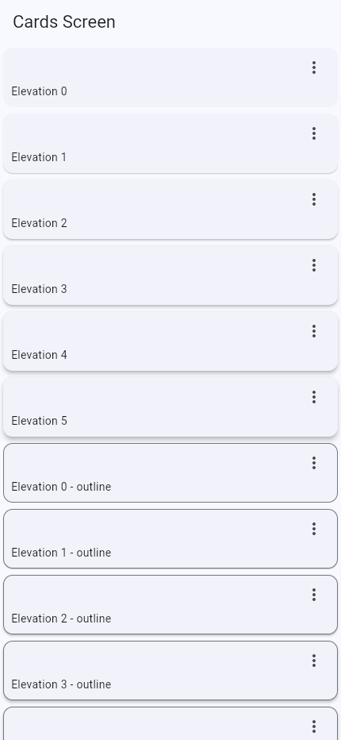 | **Tarjetas con imágenes**<br> | **Progreso**<br>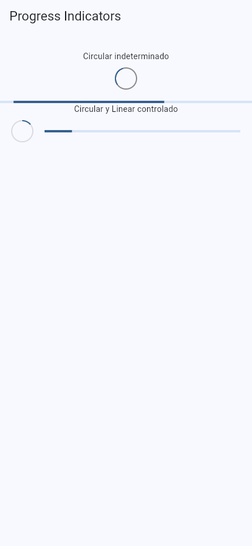 |
| **Notificaciones y diálogos**<br>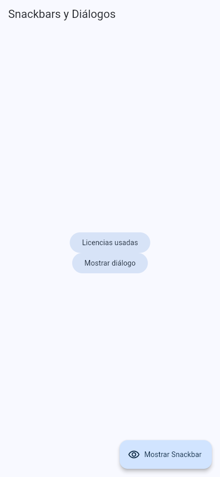 | **Confirmación**<br>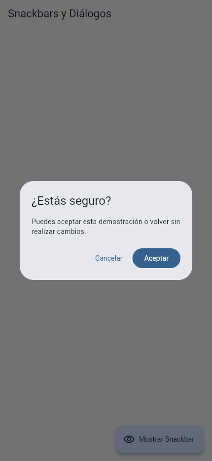 | **Acerca de**<br>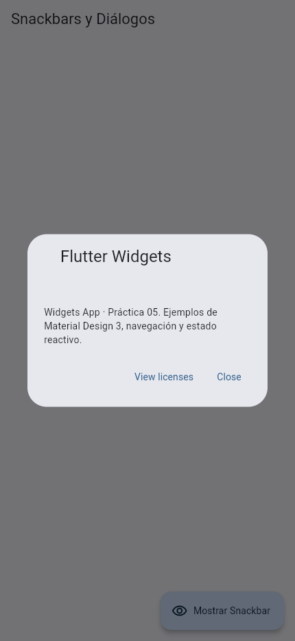 |
| **SnackBar**<br>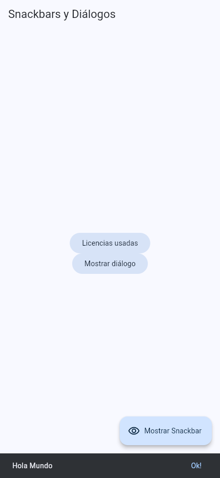 | **Animaciones**<br>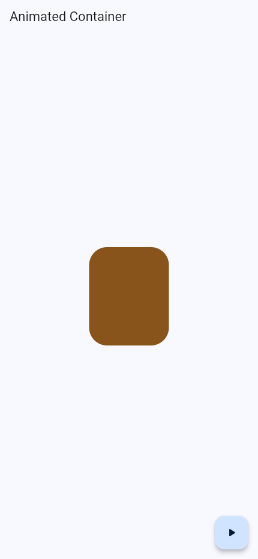 | **Controles interactivos**<br>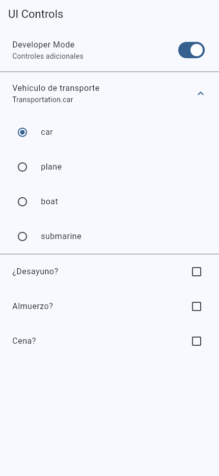 |
| **Tutorial · inicio**<br>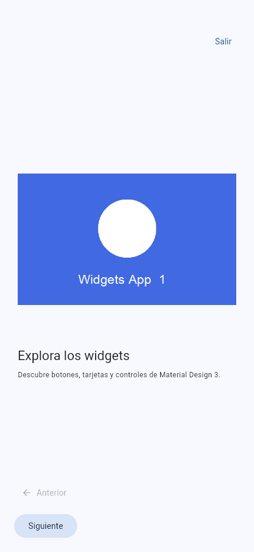 | **Tutorial · paso 2**<br>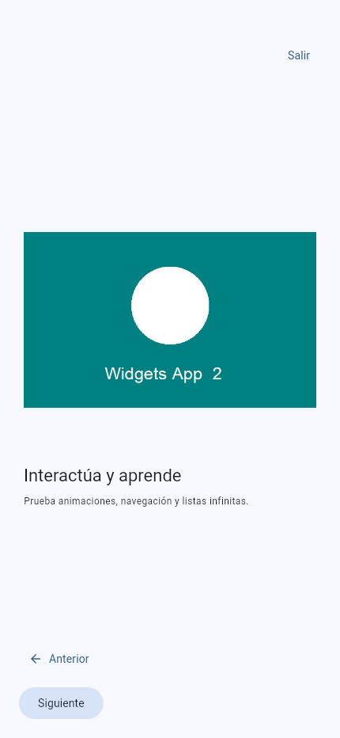 | **Tutorial · finalizar**<br>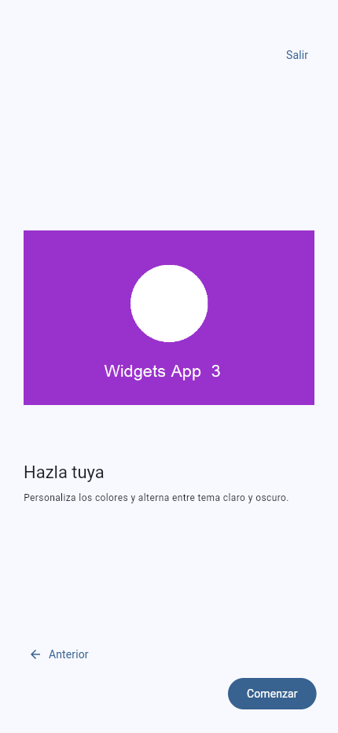 |
| **Lista infinita y refresco**<br>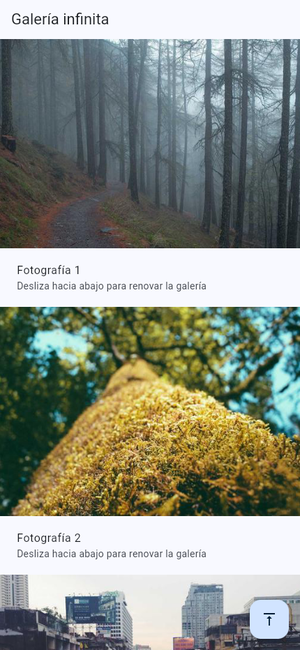 | **Colores**<br>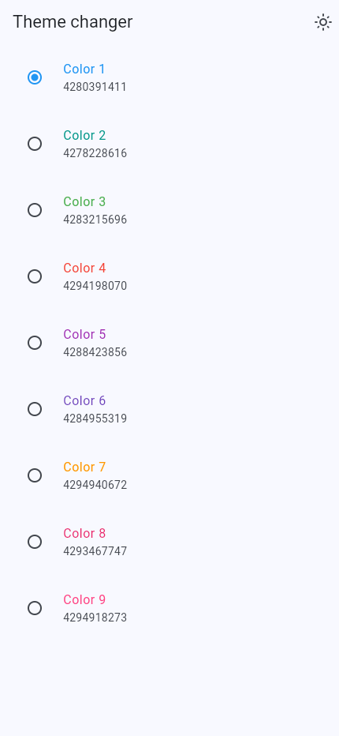 | **Tema oscuro**<br>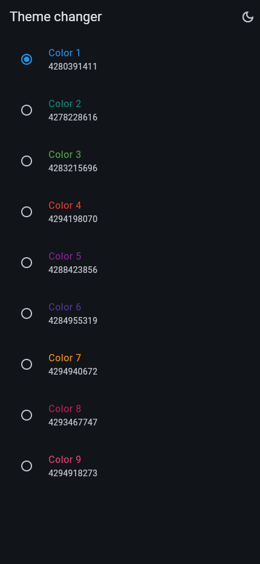 |
| **Menú lateral**<br>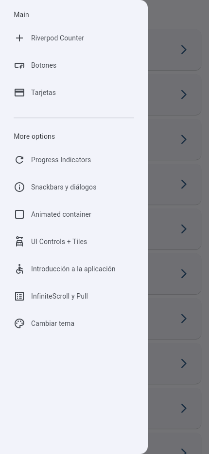 |  |  |

[Registro original de capturas](docs/evidence/screenshots/capture-report.json).

## Diagramas Archify y GitHub Pages

URLs públicas verificadas con **HTTP 200** en esta revalidación:

- [Catálogo principal de prácticas](https://ktmich2095.github.io/Practicas_DMI_230881/).
- [Portal de Práctica 05](https://ktmich2095.github.io/Practicas_DMI_230881/Practica05/widgets_app/docs/index.html).
- [Diagrama general interactivo](https://ktmich2095.github.io/Practicas_DMI_230881/Practica05/widgets_app/docs/diagrams/general.html).
- [Diagrama específico interactivo](https://ktmich2095.github.io/Practicas_DMI_230881/Practica05/widgets_app/docs/diagrams/especifica.html).

[Registro HTTP real](docs/evidence/delivery-20261109/pages-live.json). El catálogo de la raíz enlaza con rutas relativas compatibles con el subdirectorio del repositorio; las demás prácticas se conservan. En este README se usan URLs completas de Pages para abrir los visores en lugar del código HTML de GitHub. Pages se publica desde `main`, carpeta raíz; estos cambios locales no se publican automáticamente.

Los dos HTML incluyen el visor Archify con zoom, cambio de tema y exportación. Se conservan las fuentes editables [general.archify.json](docs/diagrams/general.archify.json) y [especifica.archify.json](docs/diagrams/especifica.archify.json), y los recibos históricos de generación. Los diagramas agrupan pantallas por responsabilidad: las tarjetas enumeran las rutas. No implican un backend ni persistencia.

[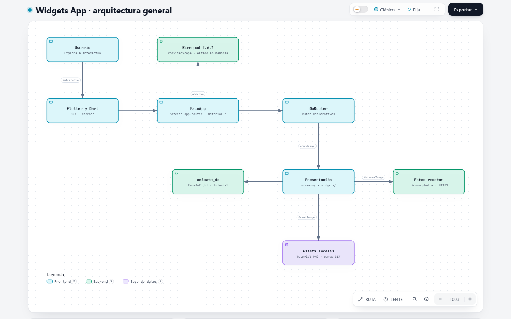](https://ktmich2095.github.io/Practicas_DMI_230881/Practica05/widgets_app/docs/diagrams/general.html)

[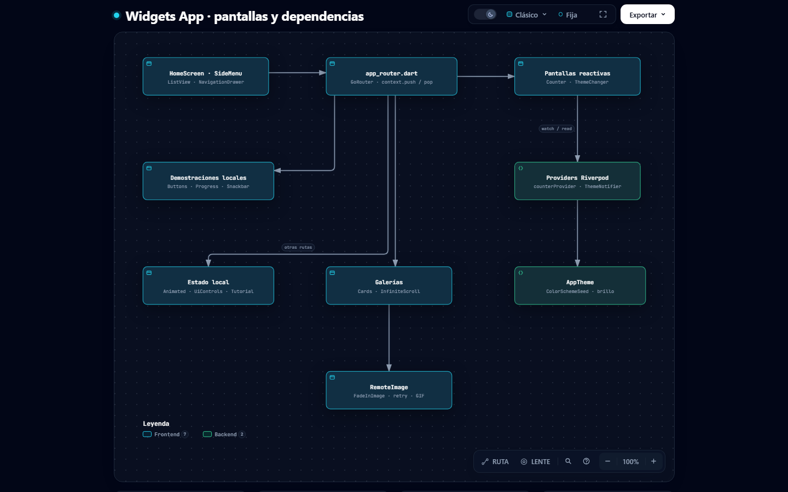](https://ktmich2095.github.io/Practicas_DMI_230881/Practica05/widgets_app/docs/diagrams/especifica.html)

## Appetize

**[Probar Widgets App en Appetize](https://appetize.io/app/b_pa45jpzvescit46pg4b3kq6dvy).** Enlace proporcionado por la usuaria y comprobado con HTTP 200. [Registro del enlace](docs/evidence/delivery-20261109/appetize-link.json).

[Instrucciones exactas y estado del APK](docs/APPETIZE.md). Appetize acepta APK/APKS; no subir el AAB directamente. Referencia: [documentación oficial de Android en Appetize](https://docs.appetize.io/platform/app-management/uploading-apps/android).

## Entrega

Revisar los cambios y publicar manualmente los archivos cuando corresponda para actualizar los botones y la documentación del sitio. No se hicieron commits, push, merge ni rebase, ni se modificaron autorías o fechas.
