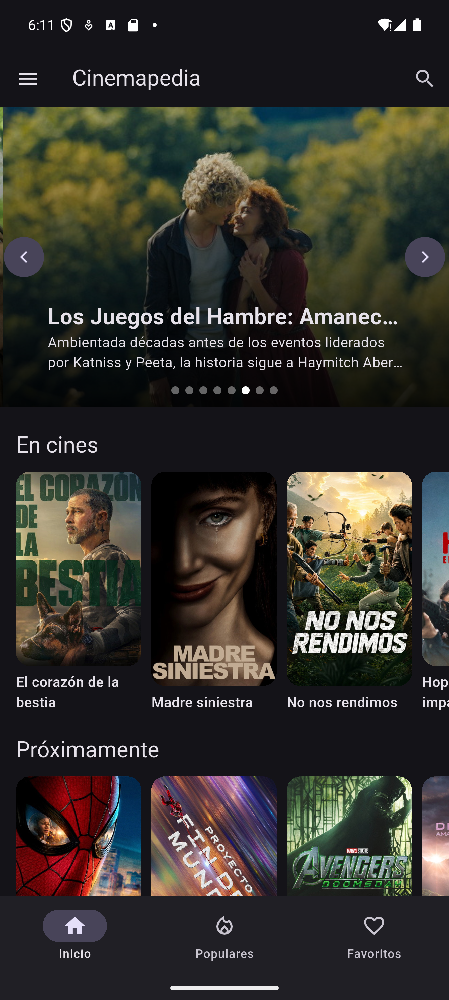
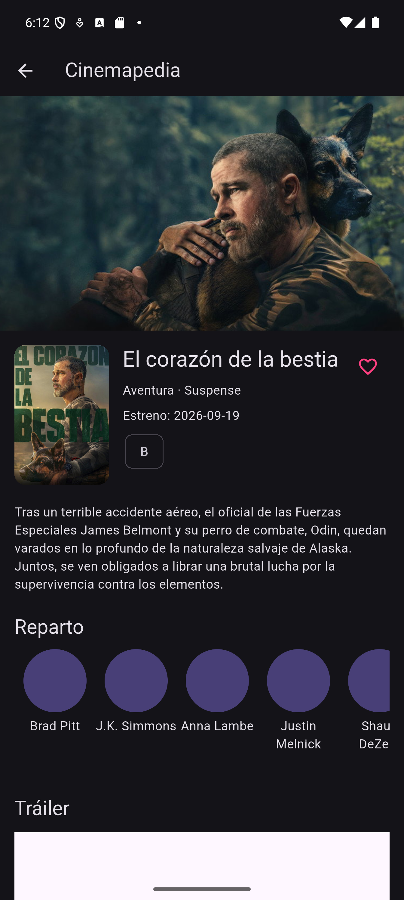
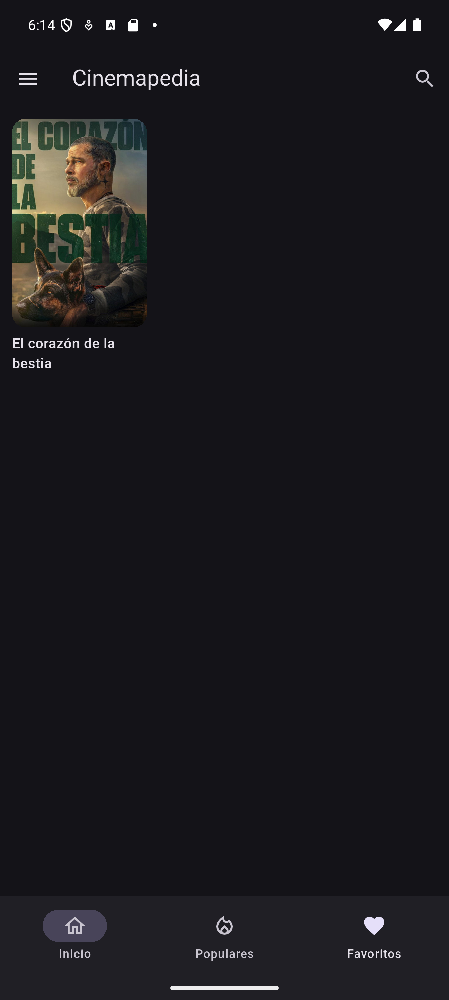
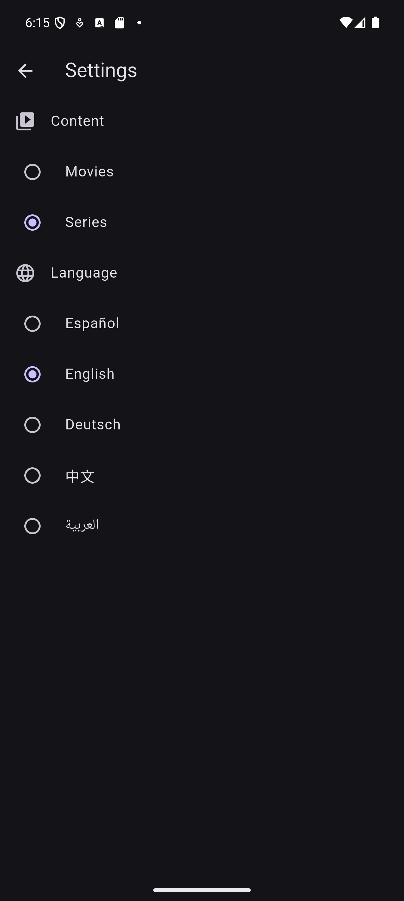
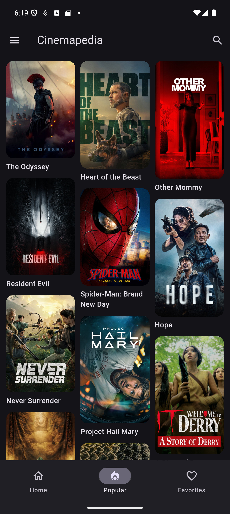
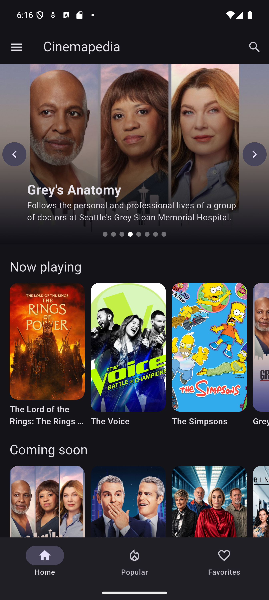
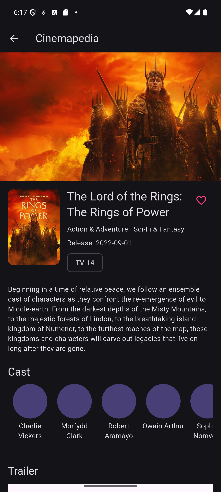
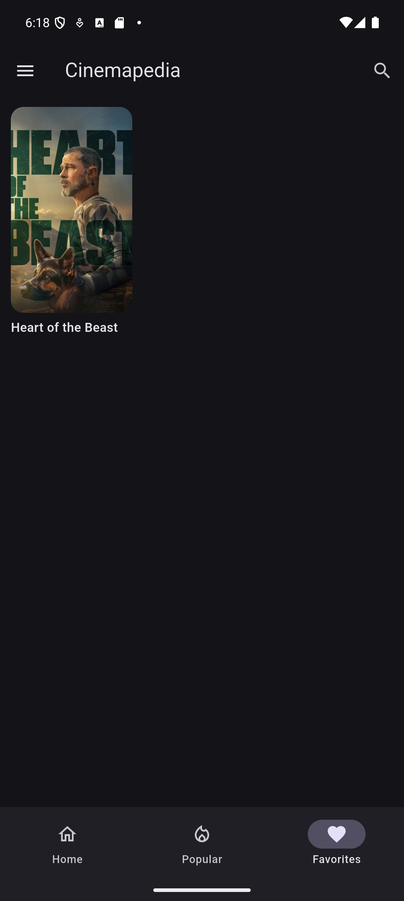
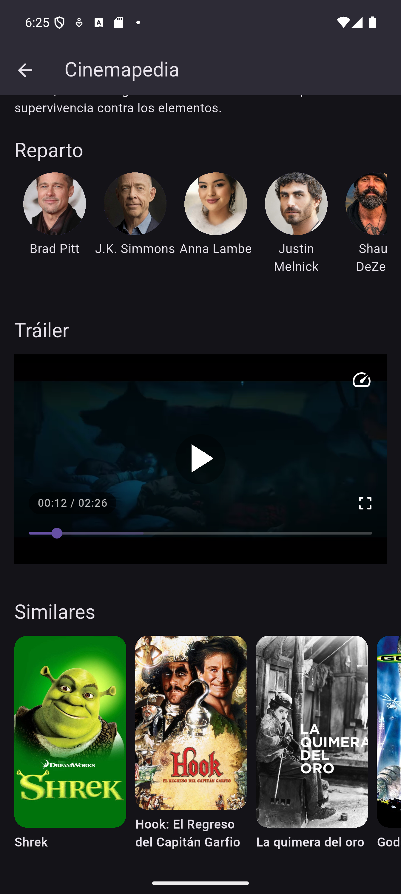
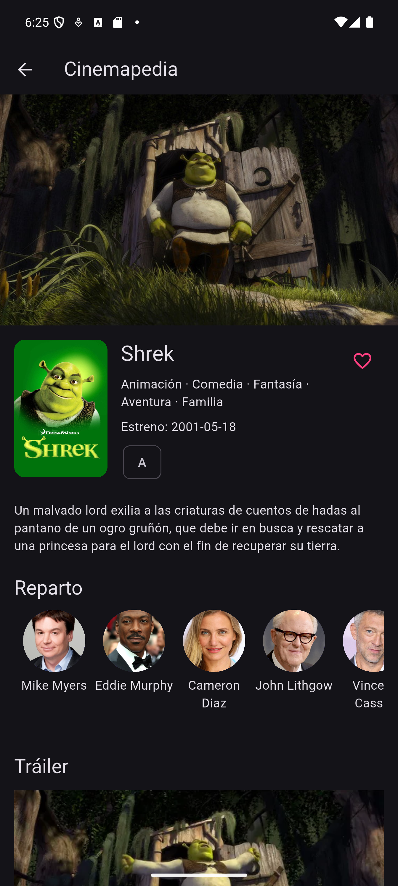

# Práctica 06 · Cinemapedia

Aplicación Flutter de películas y series con The Movie Database (TMDB). Incluye catálogo, búsqueda, detalle, reparto, tráileres, clasificación por país, favoritos y selección de idioma y contenido persistentes.

**[▶️ Probar Cinemapedia en Appetize](https://appetize.io/app/b_ozr5quvxyxm57uqu6xliznfxvi)**

## Funciones

- Películas y series, categorías paginadas, populares y favoritos.
- Búsqueda con espera breve para evitar solicitudes por cada pulsación.
- Detalle con reparto, tráiler de YouTube, similares y clasificación por país; `NR` si no hay dato.
- Español, inglés, alemán, chino y árabe, con interfaz de izquierda a derecha. Cuando falta la sinopsis del detalle, se consulta en inglés.
- Idioma, tipo de contenido y favoritos guardados localmente.

Los datos e imágenes requieren conexión y una clave TMDB válida. El tráiler depende de la disponibilidad de YouTube y de los permisos del video para reproducción integrada. Las categorías equivalentes de series son En emisión y Emisión hoy, aunque las etiquetas comparten el mismo texto del catálogo.

## Diagramas de arquitectura

| Diagrama interactivo | Qué muestra |
|---|---|
| [Arquitectura base](architecture/base/index.html) | El flujo de películas en cartelera de la versión inicial. HomeScreen usa Riverpod, el repositorio delega en el datasource y el mapper convierte la respuesta de TMDB en entidades Movie. |
| [Arquitectura actual](architecture/actual/index.html) | El flujo de la aplicación actual. Las pantallas consultan a CinemaState, que usa Dio para acceder a TMDB y SharedPreferences para guardar favoritos y ajustes. El detalle integra tráileres de YouTube. |

La arquitectura base referencia la revisión registrada en el diagrama. La arquitectura actual refleja el [punto de entrada](lib/main.dart) y la [implementación de Cinemapedia](lib/cinema_app.dart) de esta práctica.

[Ver los diagramas en GitHub Pages](https://ktmich2095.github.io/Practicas_DMI_230881/#practicas-titulo)

## Evidencias de funcionamiento

| Inicio y catálogo | Detalle de película |
|---|---|
|  |  |

| Favoritos | Configuración |
|---|---|
|  |  |

| Populares | Series después de reiniciar |
|---|---|
|  |  |

| Detalle de serie | Favorito después de reiniciar |
|---|---|
|  |  |

| Tráiler | Película similar |
|---|---|
|  |  |
